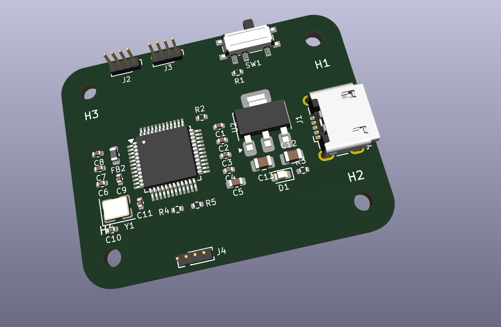
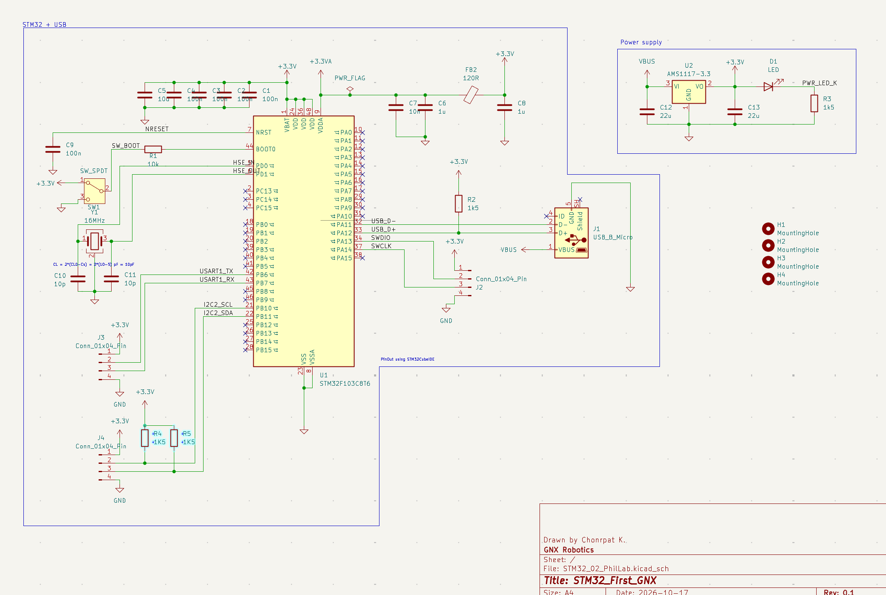

## Currently working on this Project
- I explored how to set up the board, determine trace widths for signals and power, and arrange components to ensure clean signal integrity
- I learned how to place the STM32F103C8T6 microcontroller, configure essential peripherals like USB, SWD, UART, and I2C using STM32CubeIDE, and design the power supply with an AMS1117-3.3 regulator
- I learn about peripheral things such as How to change .stp file, How to import footprint, How to edit silk screen, Positioning component with appropriate current return path
## PCB from KiCAD

## Schematic Overview

